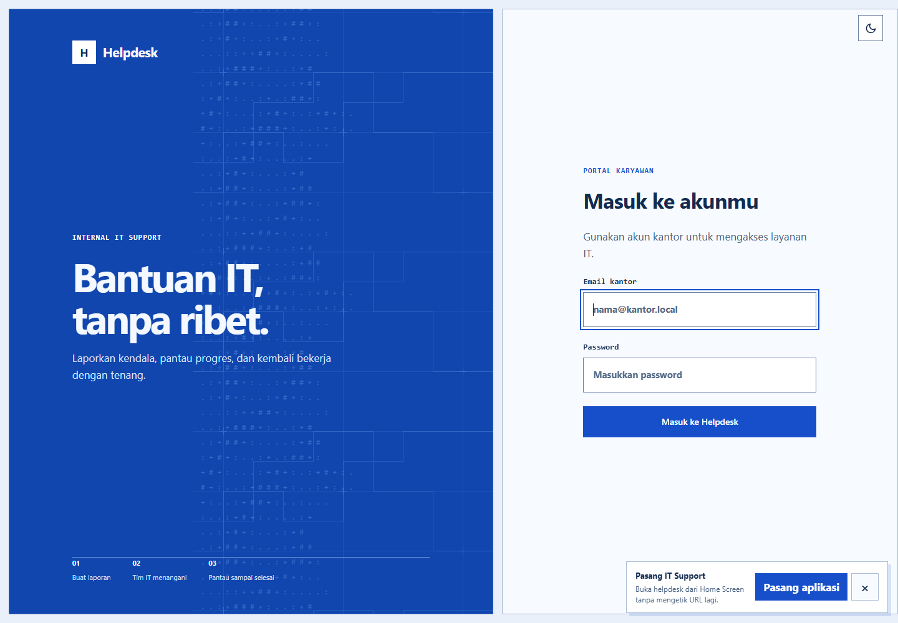

# IT Support Helpdesk

Portal internal untuk membuat tiket bantuan IT, memantau penanganan, berdiskusi dengan tim, dan mengelola akun kantor. Aplikasi menggunakan Laravel dan tetap dapat dibuka sebagai website desktop maupun dipasang sebagai PWA di perangkat yang mendukung.



## Dokumentasi

- [Panduan aplikasi, akses, arsitektur, alur tiket, PWA, keamanan, dan deployment](docs/APPLICATION.md)
- [Arah visual dan kontrak UI](DESIGN.md)
- [Preview login desktop](docs/previews/login-desktop.png)

## Teknologi

- PHP `^8.3`
- Laravel `^13.17` (versi dependency yang terpasang saat dokumentasi ini diperbarui: Laravel Framework 13.31.0)
- Composer 2.x
- MySQL atau MariaDB
- Blade, CSS, dan JavaScript biasa; tidak memakai SPA framework atau frontend bundler

Laravel 13 membutuhkan PHP minimal 8.3. Lihat [dokumentasi rilis Laravel 13](https://laravel.com/docs/13.x/releases) untuk matriks dukungan.

## Menjalankan secara lokal di Laragon

1. Pastikan PHP Laragon aktif adalah PHP 8.3. Pada mesin pengembangan project ini executable-nya `C:\laragon\bin\php\PHP-8.3.30\php.exe`.
2. Siapkan `.env`. Jika file belum ada, salin `.env.example`, lalu atur koneksi database lokal.
3. Pasang dependency dan siapkan Laravel:

   ```powershell
   if (-not (Test-Path .env)) { Copy-Item .env.example .env }
   $env:Path = 'C:\laragon\bin\php\PHP-8.3.30;' + $env:Path
   composer install
   $php = 'C:\laragon\bin\php\PHP-8.3.30\php.exe'
   if (-not (Select-String -Path .env -Pattern '^APP_KEY=.+')) { & $php artisan key:generate }
   & $php artisan migrate
   & $php artisan storage:link
   ```

4. Untuk virtual host Laragon, arahkan document root ke `C:\laragon\www\itsupport\public`. Atau jalankan server development:

   ```powershell
   & 'C:\laragon\bin\php\PHP-8.3.30\php.exe' artisan serve
   ```

Buka URL yang ditampilkan `artisan serve` atau host Laragon, lalu login memakai akun yang sudah diprovisikan. Tidak ada kredensial default di repository. Jangan menjalankan seeder atau reset database pada data kantor tanpa prosedur backup dan persetujuan yang sesuai. Migration helpdesk memeriksa tabel yang sudah ada, menambah kolom `sla_deadline` jika belum ada, dan `down()`-nya tidak menghapus tabel.

## Fitur

- Buat, lihat, saring, dan ekspor tiket; tiket memiliki status, prioritas, kategori, SLA, assignee, komentar, aktivitas, dan catatan penyelesaian.
- Hak akses berbasis role `employee`, `it`, dan `admin`.
- Kelola akun kantor oleh Admin.
- Dashboard dengan antrean kerja, ringkasan, analitik untuk role yang berhak, serta polling aktivitas.
- Layout responsif, pilihan tema, navigasi install aplikasi, dan PWA online-first.

Detail alur dan batas akses ada di [docs/APPLICATION.md](docs/APPLICATION.md).

## PWA dan batasan offline

Manifest dan service worker tersedia di `public/`. Service worker menyimpan asset statis publik dan halaman offline, bukan halaman login, dashboard, API, atau data tiket. Request navigasi selalu menuju server; saat gagal, aplikasi menampilkan fallback offline. Membuat atau mengubah tiket tetap memerlukan server dan tidak masuk antrean offline.

Untuk pemasangan di Android gunakan browser yang mendukung install prompt dan HTTPS pada deployment. Di iPhone, gunakan Safari → Share → Add to Home Screen. Jika prompt otomatis ditutup, pilihan pemasangan tersedia lewat menu aplikasi. Push notification belum diimplementasikan.

## Pemeriksaan dan deployment

Perintah pemeriksaan yang tersedia:

```powershell
php artisan route:list
php artisan view:cache
php artisan test
```

Sebelum production: aktifkan HTTPS, set `APP_ENV=production` dan `APP_DEBUG=false`, gunakan kredensial database khusus, siapkan backup database dan berkas upload, lalu verifikasi akses lampiran sesuai kebutuhan kerahasiaan organisasi. Lihat catatan keamanan dan deployment di [docs/APPLICATION.md](docs/APPLICATION.md).

Branch utama repository adalah `master`.
